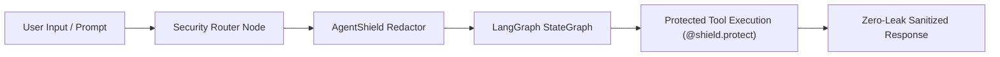

<div align="center">

# LangGraph AgentShield Template 🛡️

[](https://github.com/RitualDev-Lab/langgraph-agentshield-template/generate)
[](https://pypi.org/project/agentshield-defense/)
[](https://www.python.org/)
[](https://ritualdev.in)
[](https://ritualdev.in/trust)

> **Production Python LangGraph Multi-Agent Architecture with `@shield.protect` Zero-Leak Sandboxing, Callback Interceptors, and Prompt Redaction.**

[Documentation](https://ritualdev.in/docs) • [PyPI Package](https://pypi.org/project/agentshield-defense/) • [Security Advisories](https://ritualdev.in/advisories) • [Trust Center](https://ritualdev.in/trust)

</div>

---

## ⚡ What is this?

When autonomous AI agents built with **LangGraph, CrewAI, AutoGen, or LlamaIndex** execute tools and retrieve database records, they frequently encounter volatile credentials (database connection strings, bearer tokens, AWS keys, `/proc/self/environ` reads).

This template provides an enterprise-ready LangGraph multi-agent graph with **AgentShield Defense** built directly into tool calls and state transitions:



---

## 🚀 1-Click Quickstart

### 1. Click "Use this template"
Click the green **[Use this template](https://github.com/RitualDev-Lab/langgraph-agentshield-template/generate)** button above to create your own repository.

### 2. Clone & Install
```bash
git clone https://github.com/YOUR_ORG/YOUR_REPO.git
cd YOUR_REPO

# Install dependencies (includes agentshield-defense)
pip install -r requirements.txt
```

### 3. Run the Secure Agent
```bash
python -m src.agent
```

### 4. Run the Test Suite
```bash
pytest tests/ -v
```

---

## 🛡️ Key Defense Mechanisms

1. **`@shield.protect` Decorator**:
   Wraps custom tools and function invocations. Automatically redacts 40+ credential types from tool return values.
2. **`AgentShieldCallbackHandler`**:
   Attaches to LangChain / LangGraph execution loops to intercept LLM prompts and model outputs.
3. **Subprocess & Sycall Traps**:
   Prevents hostile prompt injection payloads from dumping `/proc/self/environ`, `~/.ssh/id_rsa`, or environment configurations.

---

## 📄 License & Responsible Disclosure

- Licensed under **Apache-2.0**.
- Coordinated Vulnerability Disclosure: [security@ritualdev.in](mailto:security@ritualdev.in) (SLA < 24h).
- Maintained by [RitualDev Studio](https://ritualdev.in).
